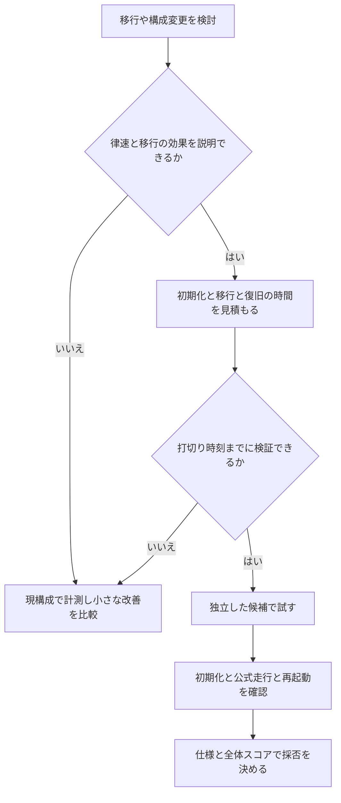
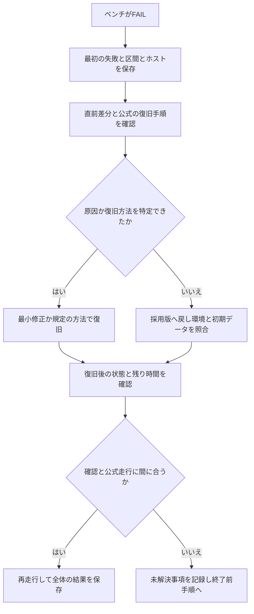

# 参加記から学ぶ実践ノウハウ

[共通手順書](isucon-playbook.md) の判断を、Zenn・Qiita・個人ブログ・コミュニティブログの実例で具体化する。
出典の記事が扱う大会・練習環境と、その当事者の観測を明記する。記事の得点を手元で再測定したものではない。
以下の確認手順は事例から一般化した提案であり、性能効果と仕様適合は適用先で検証する。
記事一覧は [出典索引](isucon-pattern-sources.md#参加記と技術記事)。

## 1. 計測対象と区間が合っているかを確かめる

解析結果が出たら、まず負荷が通った経路を計測できているか確認する。

| 確認対象 | 確認方法 |
| --- | --- |
| 実際の入口 | Host名、TLS、port、vhost、proxy、upstreamをたどり、既知の要求が対象ログに出るか確認 |
| 全アプリと依存先 | ホスト・プロセス・DB・DNS・workerの配置表と、計測対象を照合 |
| 負荷の時刻 | 予約、初期化、負荷開始・終了、最終検証の実時刻を区別し、profileの採取区間を確認 |
| 集計の網羅性 | 生ログの件数と集約後の件数を突き合わせ、可変URL、失敗、少数の遅い要求を落としていないか確認 |
| 実行の識別 | ログ・profile・公式結果に同じ実験ID、ホスト、revision、時間区間を付ける |

ISUCON11予選のakiragoさんはHTTP側の設定を変更し、実際のHTTPS側への対応に終盤で気づいたと記している。
10本選のHiro Suzukiさんは、事前の計測が単一アプリ前提で、当日の二つのアプリを扱えなかったと振り返っている。
[Qiita: akirago](https://qiita.com/akirago/items/c3581551177887308a72)、
[Zenn: Hiro Suzuki](https://zenn.dev/hirosuzuki/articles/dfb6014229b6c4)。

ベンチの順番待ちがある環境では、予約操作と同時に短いprofileを開始すると負荷区間を逃し得る。
開始検知や初期化フックを使う場合も、初期化後に負荷開始まで待ちがあるかを含め、実際の区間を確認する。
13のEichiSandenさんは、待ち行列と手動pprof開始待ちが作業を妨げたと報告している。
[Qiita: ISUCON13に参加した](https://qiita.com/EichiSanden/items/2d5ed6af74a0de7f40b1)。

さんちゃさんの11予選参加記では、古いデバッグ時の500ログを正常な走行のログと混同して調査を続けた。
ログ退避と転送を分け、走行ごとの区間を確実に識別する。証拠を保存せずログを削除して解決した扱いにはしない。
[個人ブログ: ISUCON11を振り返る](https://dawn.hateblo.jp/entry/2021/09/05/001027)。

## 2. 変更が実際に使われたかを確かめる

効果がないときは「施策が効かない」と「変更が利用されていない」を分ける。
アプリの配置先、稼働バイナリ、読み込まれた設定、初期化後の索引・追加テーブルを照合する。
キャッシュならhit/missと元のSQL回数、読取先の変更なら実際の接続先と処理件数で確認する。

12予選のmazreanさんは、キャッシュ更新だけ実装し読取処理の置換を忘れていたと記録している。
14のblue_jamさんは、追加SQLを初期化へ組み込んでいなかったことを報告している。
変更箇所への到達を確認してから、全体スコアで採否を決める。
[コミュニティブログ: mazrean](https://trap.jp/post/1631/)、
[個人ブログ: blue_jam](https://blue-jam.hatenablog.com/entry/2024/12/09/191712)。

## 3. 資源に余裕があるときは負荷の入口も調べる

CPUが低い理由には、lock・pool・外部待ちのほか、利用者が次の行動へ進めていない可能性がある。
時間ごとの登録成功数、ログイン、同時利用者数、通知、加点される完了数を並べ、どこで増加が止まるか調べる。
入口を改善すると後続の負荷も増えるため、変更後は資源とエラーをもう一度測る。

sorahさんは13の参加記で、登録処理の遅さが負荷の頭打ちの原因だった可能性を振り返っている。
これは著者の推測として扱い、同じ症状が必ず登録処理に起因するとは判断しない。
[個人ブログ: ISUCON 13 参加記](https://diary.sorah.jp/2023/11/28/isucon13)。

## 4. キャッシュ再構築の殺到と更新直後の読取を分ける

キャッシュの一斉失効や版更新で、同じデータの再取得が同時に大量発生していないか調べる。
12本選のとーふとふさんは、master更新時の重複再構築をsingleflightで抑え、得点のばらつきが減ったと報告している。
その結果は当該構成での経験であり、どの処理にも同じ効果が出る保証ではない。
[Zenn: ISUCON12で優勝しました](https://zenn.dev/tohutohu/articles/8c34d1187e1b21)。

singleflightは同一キーで進行中の呼出しの結果を共有する仕組みで、共有結果の鮮度を保証するものではない。
例えば次の順序では、Bが自分の更新より古い結果を受け取る可能性がある。

```text
A: 更新前の状態を読む計算を開始
B: 同じデータを更新し、更新が完了
B: 同じキーの実行中処理へ合流
A: 古い状態を基に計算完了 → Bもその結果を受け取る
```

methaneさんは7本選の事前チューニングで、この種の不整合を経験したと説明している。
更新後の読取が必要なら、必要な世代、計算が読む状態、共有可能な要求の範囲を設計する。
更新前から進行中の計算へ無条件に合流させず、更新後の状態を使う再計算や適切な排他を検討する。
プロセス内の重複抑制と、複数ホスト間の更新反映も区別する。
[Qiita: singleflightの注意点](https://qiita.com/methane/items/27ccaee5b989fb5fca72)、
[公式: singleflight](https://pkg.go.dev/golang.org/x/sync/singleflight)。

読取先をレプリカへ分ける場合も同じ契約を確認する。
10予選のlostfindさんは、更新がレプリカへ反映される前のGETで不正判定になり、固定sleepでも解消しなかったと報告している。
更新直後の結果が必要な経路は、正本への読取や必要な同期を設計する。固定sleepを反映完了の証明にしない。
[Qiita: ISUCON10予選の失敗](https://qiita.com/lostfind/items/40f77453f8c91d49014e)。

## 5. 一括化とSQL書換えの境界を確認する

変更に応じて、次の入力・状態で仕様を保つことを確認する。

| 境界 | 確認すること |
| --- | --- |
| 0件 | 空の`VALUES`や`IN ()`を組み立てない。空結果のレスポンスも維持 |
| 1件と多数件 | まとまりの分割、パラメータ数、メモリ、処理時間、途中失敗を確認 |
| 同順位 | ソートの第2キー以降も保持し、ページ境界の並びを変えない |
| 欠損・重複・NULL | JOINで増える行、消える行、未存在時の応答と集計値を確認 |
| 同時更新・再試行 | 二重加算や二重割当を防ぎ、どの状態の結果を返すかを確認 |

Icemanさんの13参加記には、空の一括INSERTによる構文エラーが記されている。
Hiro Suzukiさんの10予選参加記では、第2ソートキーを外した変更後に初期検証エラーが増え、差分を戻した。
後者の詳細な因果は記事だけで確定できないため、順序の境界を確認する事例として扱う。
[Zenn: Iceman](https://zenn.dev/iceman/articles/5aad04f18b128f)、
[Zenn: Hiro Suzuki](https://zenn.dev/hirosuzuki/articles/8a4f91d5dc384cba534d)。

## 6. 排他と構成変更はデータの公開順まで見る

lock待ちを見つけたら、lockを保持する処理と、その中のSQL・外部通信・計算を計る。
方式を置き換える候補と、同じ方式で保持時間を減らす候補を比べる。
12予選のdaijuさんは、flockをDB transactionへ置換するとdeadlockが多発したため戻し、lock内のN+1削減に注力した。
[Zenn: Rustで予選突破した](https://zenn.dev/daiju/articles/165da7a5589434)。

複数ストアにまたがる作成では、親レコード、実体ファイル、初期データがそろう前に、一覧やworkerへ公開されないかを調べる。
12予選のmpywさんは、MySQL上のテナントがSQLiteファイル作成前に見える経路を後から原因と判断した。
単一DBのtransactionだけで複数ストアの原子性を保証できるとは扱わず、作成途中・失敗・再試行の公開条件を決める。
[Qiita: ISUCON 12 初参戦レポート](https://qiita.com/mpyw/items/37f053b322f24dde52e1)。

構成変更時は次の経路をセットで移す。通常リクエストだけが動く状態で移行完了としない。

- アプリとDBの接続先、名前解決、session、cache、アップロードファイル。
- 初期化スクリプトのDB・ファイル操作先、索引や追加データの再現。
- systemdの起動・停止依存、定期処理とworkerの実行先・個数。

8のmoezakuraさんはDB分離後、初期化スクリプトの接続先変更が必要だったと記している。
13のEichiSandenさんは、未使用APの停止に伴い依存関係のあるDBも停止したと報告している。
[Qiita: moezakura](https://qiita.com/moezakura/items/a65cfae845d85cb11edd)、
[Qiita: EichiSanden](https://qiita.com/EichiSanden/items/2d5ed6af74a0de7f40b1)。

## 7. 移行は検証と復旧の時間まで含めて判断する

12予選のcatatsuyさんは、ローカル環境構築とDB移行、初期化制限への対応に時間を使ったと振り返る。
未知のDBであることだけで移行を決めず、現構成の律速と移行後に減らせる仕事を確認する。
小さな改善を続ける経路も比較し、着手前に打切り時刻を決める。
[Zenn: ISUCON12で惨敗しました](https://zenn.dev/catatsuy/articles/da25f1128650b1)。



## 8. FAILは最初の失敗を読んでから再走行する



スコアが付かない原因を、アプリの差分、デプロイの未反映、設定・資源、初期データ、運営側の告知に分ける。
12予選のpuddingさんは、不安定な整合性エラーを一度コードの差分として疑ったが、手動変更された初期データが原因だったと記録している。
正常な配布データや検証済みコピーと照合する。修復するときは大会の初期化仕様を維持する。
[個人ブログ: ISUCON12予選突破の記録](https://poyo.hatenablog.jp/entry/2022/07/28/202245)。

原因を特定せずに再実行して偶然PASSした結果だけで、再現性を確認した扱いにしない。
Icemanさんの13参加記には、競技後にマニュアル記載の復旧手順へ気づいた反省もある。
その手順で当時の問題が直ったかは未確認であり、汎用化するのは「復旧手順を先に確認できるようにする」判断である。
[Zenn: ISUCON13 参加記](https://zenn.dev/iceman/articles/5aad04f18b128f)。

## 9. 分担しても観測と完了確認は共有する

ベンチ予約、デプロイ、ログ転送を一人に依存させる場合は、待ち時間と作業滞留を確認する。
自動化する範囲と、共有状態を変更するときの調整を決め、公式結果とシナリオログは全員が読める状態にする。
14のTakeno_hitoさんは、ベンチ担当を分けて自分でログを見なくなり、マッチングの問題を見落としたと振り返っている。
[当事者記事: Takeno_hito](https://trap.jp/post/2441-2/)。

終了前の確認はホスト別に「構成・時刻・実行結果・未解決事項」を記録する。
環境チェックや再起動を誰かが開始したことと、全対象で成功を確認したことを区別する。
一部を修正した場合は影響範囲を確認し直し、結果を見ていない対象を完了扱いにしない。
