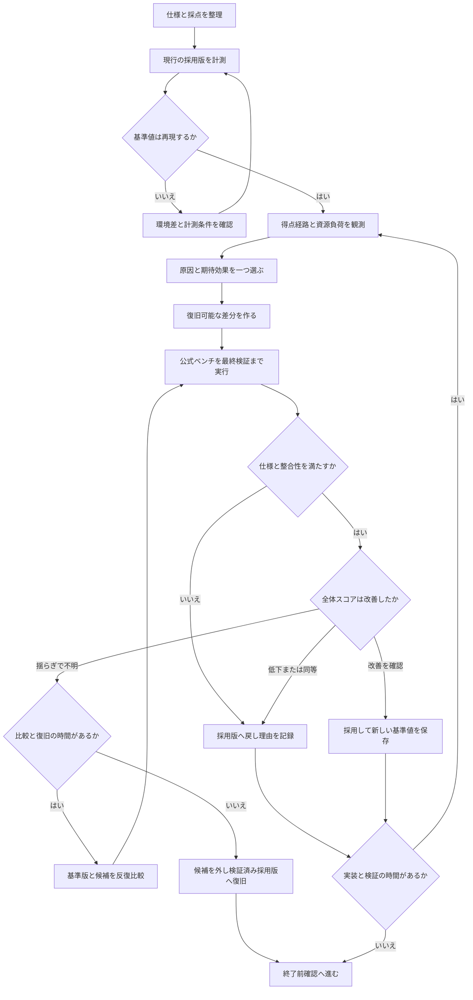
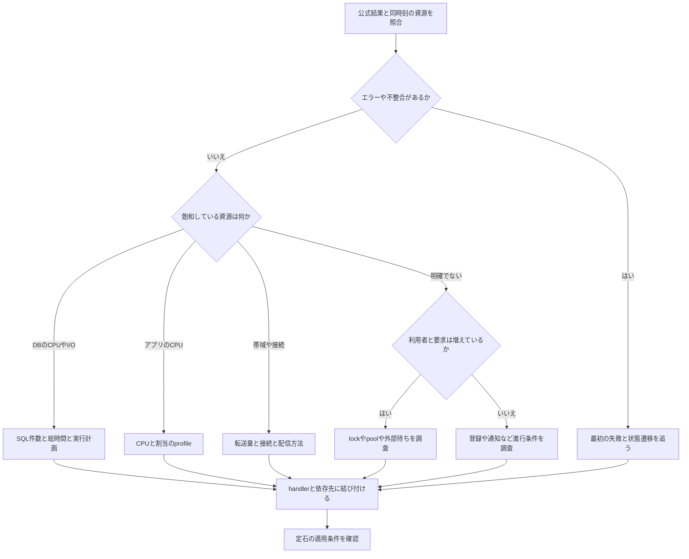
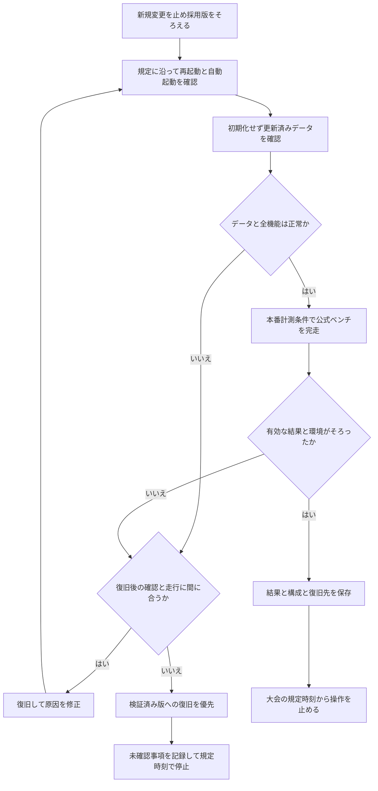

# ISUCON共通の定石と改善フロー

更新日: 2026-10-28。ISUCONの開催回・予選/本選・実装言語を問わず使うための手順書。
各回の公式資料と当事者の参加記から繰り返し現れる課題を分類し、当日の判断フローへ整理した。
各施策の採否は、適用先の公式ベンチマークと仕様の確認で決める。

当該回のレギュレーション、当日マニュアル、アプリ仕様、運営の訂正・告知を優先する。
サーバー台数、負荷時間、反映猶予、最終スコアの選び方、追試の合格基準は大会ごとに記入する。
ISUCON14の「3秒」「75%」などを他の回へ転用しない。

## 読み方

- 開始時: [仕様の整理](#1-最初に仕様と採点を整理する) → [基準値](#2-再現可能な基準値を作る)。
- 走行後: [改善ループ](#3-改善ループ) → [原因の切り分け](#4-計測から原因を切り分ける)。
- 実装前: [定石の選び方](#5-定石は観測結果に合わせて選ぶ) → [採否判断](#6-候補を採用する条件)。
- 終了前: [最終確認](#8-終了前のフロー)。調査の根拠は [公式資料と参加記の索引](isucon-pattern-sources.md)。
- 想定外の結果: [参加記から学ぶ実践ノウハウ](isucon-field-notes.md) で、観測漏れ、変更の未反映、競合、FAILの切り分けを確認。
- SQL以外の待ちや小さい得点差: [計測と並行処理の実践手順](isucon-measurement-and-concurrency.md) で、同一区間の観測、接続保持者、外部副作用、batchの境界を確認。

## 1. 最初に仕様と採点を整理する

次の表をチームで埋める。処理速度が得点へどうつながるかを先に把握する。

| 記入項目 | 確認する内容 |
| --- | --- |
| 得点 | 成功数、売上、完了件数、距離など、何が加点されるか |
| 利用者の行動 | どの応答・通知を待って次の行動へ進むか |
| 負荷の増え方 | 時間、成功、評価、登録、招待などで利用者やデータ量が増えるか |
| 正しさ | 認証・権限、順序、重複、金額、在庫、同時更新、表示をどう保証するか |
| 期限 | 初期化、各API、通知、非同期反映、負荷終了後の完了期限 |
| 初期化 | どのデータ・ファイル・キャッシュ・外部接続先を戻すか |
| 永続化 | 再起動後に何が取得できなければならないか |
| 環境 | 利用可能な資源、変更禁止のユーザー・ファイル・ポート |
| 終了条件 | 最終スコアの選定、必要な稼働状態、追試、操作停止時刻 |

加点される行動から逆向きに、必要なAPI・DB・外部サービス・workerをたどる。
「リクエストを多く返す」と「加点される仕事を完了する」が一致するかを確認する。
ISUCON2ではチケット販売、9予選では売上、13ではTipsの合計が評価対象だった。
[公式資料: 2](https://isucon.net/archives/30154200.html)、
[9予選](https://isucon.net/archives/53789931.html)、
[13](https://isucon.net/archives/58001272.html)。

ブラウザで主要操作を一度行い、データの作成・更新・一覧・通知のつながりを確認する。
公開されているベンチマーカーのコードは仕様理解の補助に使い、仕様で要求される振る舞いを保つ。

## 2. 再現可能な基準値を作る

1. 接続先、サービス、実行バイナリ、DB、定期実行・workerの配置を図か表にする。
2. 元のソース、設定、スキーマ、初期化方法、復旧手順を保存する。設定のバックアップとDBデータのバックアップを区別する。
3. 無変更で公式ベンチマークを完走し、結果とエラーを保存する。
4. 計測設定を導入し、同じ条件で基準値を取り直す。ログやprofileの負担も条件に含める。
5. 基準値が不安定なら無変更で再測定し、デプロイ違い・他の走行・設定差・資源競合を先に調べる。

初期状態でFAILする場合は、最初の失敗を保存し、最小限の修正で比較可能なPASS状態を作る。
その状態を改善比較の基準にする。

ソースrevision、バイナリのhash、実効設定、DB索引、初期データ、ベンチマーカーの版と対象を記録する。
練習時にベンチを同居させる場合は、そのCPU・メモリ・帯域の消費を含む条件として扱う。
初回の公式再現手順でも、初期データ投入やベンチ実行環境による結果の差が説明されている。
[ISUCON1の公式再現手順](https://isucon.net/archives/30155170.html)。

このrepoのコマンドは [READMEの開始手順](../README.md#試合開始時) に従う。
計測準備後の流れは次のとおり。実行場所は設定済みの競技サーバー上とする。

```bash
make bench
# 大会指定の方法でベンチマーカーを実行し、最終検証まで待つ
make slow-off analyze
```

`make bench` はビルド・ログ退避・サービス再起動・全クエリ記録開始を行う。
ベンチマーカー自体は起動しない。共有環境では走行担当を決め、同時デプロイや再起動を避ける。
`analyze` が失敗した場合も生ログと公式結果を確保し、集計失敗とベンチ失敗を区別する。
最初に既知のリクエストが対象ログへ出ること、全ホスト・全アプリが計測対象であることを確認する。
予約時刻と実際の負荷開始を分け、計測区間がずれていないかを確認する。
具体例は [計測対象と区間の確認](isucon-field-notes.md#1-計測対象と区間が合っているかを確かめる) を参照。

環境を変更した後（ログ・一時ファイルの置き場所、DBの設定、サービスの追加・削除）は、ベンチを投入する前に初期化APIを直接呼び、
成功することを確かめる。初期化の処理は、DNSのzone再読込やDBの再作成のように、普段は動かない外部コマンドを含むことが多い。
そのため、変更の影響は初期化で初めて表に出る。

手元の再現環境では、次の2つの失敗が初期化の失敗やサービスの起動失敗として現れた。

- ログをRAMへ移す候補を撤去した後、zone初期化スクリプトだけが消えた一時ディレクトリを参照したまま残っていた。
  初期化が500を返し、ベンチは0点になった。
- RAM上のDBに設定のoverlayを追加して再起動したところ、起動前の検査が「継承した設定が変わった」として起動を拒否した。

対策として、次を確かめてから投入する。

- 撤去・移動したパスを参照しているファイルがないか、配置済みのスクリプト・unit・設定をgrepで調べる。
- DBやproxyの設定を変えたら、サービスがactiveになったことを確かめる。
- 初期化APIを1回直接呼んで成功させる。成功したら、その時点の稼働版を記録する。

外部の負荷走行は待ち行列や回数の制約があることが多いので、手元で分かる失敗に使わない。

## 3. 改善ループ



候補は現行の採用版から一つずつ比較する。棄却した候補の上に次の候補を積まない。
複数人で開発しても、比較する差分と走行対象は一意にする。採用後は計測し直す。
改善で別の処理が増えるため、前回のボトルネックを追い続けない。
期待した効果が出なければ、変更したコード・索引・キャッシュが実際に利用されたかも確認する。
[変更の使用確認](isucon-field-notes.md#2-変更が実際に使われたかを確かめる) を済ませてから、施策の効果を判断する。
ISUCON11予選の講評でも、典型的な問題を見つけて直すだけでは得点が伸びない設計が説明されている。
[ISUCON11予選公式解説](https://isucon.net/archives/56044867.html)。

## 4. 計測から原因を切り分ける

まずベンチ結果の成功・失敗・タイムアウトと、同じ負荷区間のホスト別・プロセス別の資源使用を見る。
初期化、事前検証、負荷、負荷終了後、最終検証は区別する。CPUはコア単位でも確認する。



同時に複数の原因がある場合は、加点経路の進行を最も妨げている箇所から一つ選ぶ。
CPU使用率の低さだけで余裕があるとは判断しない。次の表は調査の入口であり、原因の確定ではない。

| 観測 | 次に見るもの | 対応候補 |
| --- | --- | --- |
| DB CPU・走査行数が多い | slow logの件数・総時間、実行計画、索引 | 索引、取得範囲、N+1、事前集計 |
| SQLは短いのにHTTPが遅い | 接続pool待ち、transaction保持、外部通信 | 保持範囲の短縮、競合・外部待ちの解消 |
| アプリのCPUが高い | CPU profile、割当、GC、呼び出し回数 | 重複計算・変換・コピー・不要取得の削減 |
| 低CPUで遅延が大きい | goroutine/thread、lock、pool、worker待ち | 排他範囲、並行数、ジョブ供給の調整 |
| I/O待ち・書き込み遅延が増える | I/O量、ログ量、書き込み・commitの頻度 | 不要なI/O削減、集約、永続化を保つbatch化 |
| 帯域・接続数が増える | 応答サイズ、画像、静的配信、再接続 | 条件付きGET、配信経路、接続再利用 |
| 後半だけ悪化する | データ増加、一覧サイズ、queue、メモリ | 取得量の上限、索引、集約、滞留対策 |
| HTTPが速いのに得点が低い | 加点までの待ち、通知、割当、外部完了 | 利用者の行動経路・アルゴリズムの改善 |
| 資源に余力があるのに負荷が増えない | 登録・ログイン等の入口、利用者数と要求数の推移 | 後続の負荷を生む進行条件の改善 |

HTTPはメソッドとルートごとの件数・総応答時間・分位値・ステータスを比べる。
動的IDを適切にまとめ、平均だけで大量の短い処理を見落とさない。
ただしSSEなどの長時間接続は接続寿命とイベント遅延を分け、通常APIの総時間と単純比較しない。
[alpの公式ドキュメント](https://github.com/tkuchiki/alp)。

DBも単発の最遅SQLだけでなく、同形SQLの総時間・実行数・走査量を見る。
並行処理の総時間は壁時計時間やCPU占有率ではない。handler、接続pool、lockの計測と照合する。
[pt-query-digestの公式ドキュメント](https://docs.percona.com/percona-toolkit/pt-query-digest)。

GoのCPU profileはCPU実行中の処理を示す。I/Oやpool待ちにはgoroutine、block、mutex、traceなどを目的に応じて使う。
計測の負担と相互干渉を考慮し、raw profile・対象バイナリ・revisionを残す。
他言語でもCPU実行と待機を分けて調べる。
[Go公式の診断ガイド](https://go.dev/doc/diagnostics)。

poolの待機者から保持者を特定する手順、全クエリ記録の負担、複数ホストの区間合わせは
[計測と並行処理の詳細](isucon-measurement-and-concurrency.md#2-同じ負荷区間で全ホストを観測する) を参照する。

## 5. 定石は観測結果に合わせて選ぶ

以下の順序は固定の実装順ではない。小さな差分で現在の律速を改善できるものを優先する。
見込み効果に加えて、実装・検証・復旧に必要な時間と整合性への影響を評価する。

| 定石 | 使う条件・変更 | 守る条件と確認 |
| --- | --- | --- |
| 索引の追加・見直し | 高頻度SQLの絞り込み、JOIN、並び順に合わせる | 実行計画と書き込み負担を比較。初期化後にも索引を再現 |
| 取得量を減らす | 不要列、全件取得、絞り込み前の集計を減らす | 権限、ページング、件数、同順位、並び順を維持 |
| N+1の解消 | JOIN、IDを集めた一括取得、要求内の再利用 | JOINの重複行、欠損、NULL、順序、クエリ肥大化を確認 |
| 計算結果の事前保持 | 同じ集計・hash・変換を繰り返す | 初期値、更新・削除・取消、再初期化、同時更新を整合させる |
| キャッシュ | 再利用できる読取結果が多い | 認証・権限・利用者・tenantをキーに反映。無効化・期限・再起動時の復元を設計 |
| 静的・画像配信 | アプリ経由の転送や同じ本文の再送が重い | 更新反映、Content-Type、認証、条件付きGET、複数ホストの実体共有を確認 |
| 接続と並行数の調整 | 接続作成やpool待ち、下流の過負荷がある | 上限を増やす前に保持時間を調査。worker増加でDBやlock待ちを悪化させない |
| transaction・排他の縮小 | 長い保持や全体lockが進行を妨げる | 在庫・残高・一意割当などの不変条件を維持。複数プロセス間の排他も確認 |
| 外部通信の削減 | 不要な往復・逐次問い合わせ・再接続が多い | API仕様、期限、失敗時の再試行、冪等性を守る |
| batch化・非同期化 | 呼出し単位の固定費が大きく、遅延が許容される | 反映・完了期限、順序、重複、queue上限、永続化と再実行を設計 |
| 通知方式の改善 | 無変更pollingや通知待ちが支配的 | 許容された方式を選択。順序、欠落、再接続、切断後の解放を確認 |
| アルゴリズムの改善 | 全探索、重複走査、選択方法が律速 | 精度・業務条件と計算時間を比較。単体の最適と全体スコアを分ける |
| 複数台の活用 | 分離できる負荷があり、転送・同期の費用を上回る | データ所有者、session、ファイル、cache、worker、起動順を整理 |

索引は複合キーの左端からの利用を基本に、実際の条件と実行計画で確かめる。
単列索引を並べれば複合索引と同じになるとは限らない。
[MySQL公式: 複合索引](https://dev.mysql.com/doc/refman/8.0/en/multiple-column-indexes.html)。

N+1はリストを組み立てる補助関数の呼び先まで追う。JOIN、一括取得、キャッシュの候補を比較する。
ISUCON5予選と13の公式解説には、この形の課題が登場する。
[5予選](https://isucon.net/archives/45627361.html)、[13](https://isucon.net/archives/58001272.html)。

キャッシュ・非同期化・複数台化の前には、次の契約を明文化する。

- **正本**: どのDBやファイルを復元元にするか。応答済み更新をどこまで耐久化するか。
- **更新**: 作成・変更・削除・取消・再試行・初期化の全経路で何を無効化または再計算するか。
- **並行性**: 古い読み取りの後着、差分の二重適用、初期化前の処理の後着をどう防ぐか。
- **配信**: どの主体に、どの順序で、いつまでに反映するか。再接続でどう取り直すか。
- **停止と再起動**: 受理済みの仕事を復元し、定期処理を必要な数だけ起動できるか。

項目によって許容遅延が違うAPIでは、応答全体を同じTTLで保存できるとは限らない。
ISUCON14のnearby-chairsは、位置の猶予と割当可能性の即時反映を分ける必要があった。
同じ公式解説はSSEへの移行も必須ではなかったと説明している。
[ISUCON14公式解説](https://isucon.net/archives/58869617.html)。

SSEを選ぶ場合は、アプリのflushに加えてproxyのbufferingも確認する。
nginxでは`proxy_buffering`や`X-Accel-Buffering`の扱いを確認し、クライアントで到着時刻を測る。
[nginx公式: proxy_buffering](https://nginx.org/en/docs/http/ngx_http_proxy_module.html#proxy_buffering)。

高度な構成変更も比較候補の一つとする。ISUCON12予選ではSQLite継続・MySQL移行など複数の経路が成立していた。
得意なミドルウェアへ置き換える前に、移行費用と現在の制約を確認する。
[ISUCON12予選公式解説](https://isucon.net/archives/56850281.html)。

実装前には [空入力・同順位などの境界](isucon-field-notes.md#5-一括化とsql書換えの境界を確認する)、
[更新直後の読取と同時キャッシュ更新](isucon-field-notes.md#4-キャッシュ再構築の殺到と更新直後の読取を分ける)、
[構成変更の着手条件](isucon-field-notes.md#7-移行は検証と復旧の時間まで含めて判断する) も確認する。
外部副作用をtransaction外へ移す場合は [冪等性・再検証・途中失敗の契約](isucon-measurement-and-concurrency.md#4-外部副作用をtransactionの外へ出す前に契約を決める)、
batch・索引の場合は [待ち時間と書込費用](isucon-measurement-and-concurrency.md#5-batch化と読み取り用索引は増える費用まで測る) を先に記入する。

## 6. 候補を採用する条件

公式ベンチの初期化から最終検証まで完走し、仕様を満たした候補を全体スコアで比較する。
局所的なSQL短縮やHTTP改善は、結果を説明する補助指標として扱う。

| 結果 | 判断と次の行動 |
| --- | --- |
| FAIL・仕様違反・新たな整合性エラー | 採用しない。原因とログを保存して採用版へ復旧 |
| PASS・全体スコアが明確に低下 | 採用しない。増えた別処理や競合を調べる |
| PASS・差が小さい、試行間で逆転 | 判断保留。時間があれば同条件の基準版と候補を交互に再測定 |
| PASS・改善が再現し副作用を説明できる | 採用。新しい基準値と復旧先を記録 |
| 比較条件が異なる | 結論を出さず、条件をそろえて基準値から取り直す |

反復時は最高値だけを選ばず、全試行のスコア・失敗・中央値・範囲を残す。
単発なら単発と明記する。回数や改善率に大会共通の万能な閾値を置かない。
アプリが速くなると利用者数・要求構成・データ量も変わる場合があり、同じ時間区間で比較する。

採用・棄却のどちらでも次の記録を残す。認証情報を含む生ログの公開範囲には注意する。

```text
実験ID / 対象サーバー / 時刻 / 負荷区間:
基準revision・binary hash / 候補revision・binary hash:
設定・索引・初期化・ベンチ版 / ログ・profileの有効状態:
観測した律速 / 仮説 / 今回だけの差分:
全試行の公式結果・score / エラー・timeout / 主要な成功数:
HTTP・SQL・資源・待機の変化 / artifact保存先:
採用・棄却・保留と理由 / 復旧手順 / 次の観測:
```

## 7. チーム作業と残り時間

計測・走行の担当を決め、デプロイ中、走行中、結果待ちを共有する。
コード変更は独立した差分にし、基準版・候補・採用版の取り違えを防ぐ。
複数ホストに分けた環境でも、一部の変更が共有DB・cache・workerへ影響することを確認する。
担当を分けても公式結果・シナリオログ・主要件数の推移は全員が読める場所へ置く。
計測やデプロイの担当者を、観測結果を知る唯一の人にしない。

終了前の検証時間を開始時に予約する。必要なのは「再デプロイ → 再起動 → 動作確認 → 公式走行 → 必要なら復旧して再走行」の時間。
公式ベンチの予約待ちと結果待ちも含め、各フローの「間に合うか」を判断する。
新規実装に使える時間は、その余裕を引いて判断する。高リスクな変更は実装時間だけで決めない。

## 8. 終了前のフロー



再起動前に保存済みデータの確認対象を用意し、再起動後は初期化で上書きする前に確認する。
その後に公式ベンチを実行する。再起動順に依存する接続・cache・workerも調べる。
実際の追試手順と操作可能な時間帯は当該回のマニュアルに従う。
FAIL時は [失敗の保存と復旧フロー](isucon-field-notes.md#8-failは最初の失敗を読んでから再走行する) を使う。
復旧できても、確認していない条件を検証済みとして扱わない。

- [ ] 全ホストの採用版、設定、索引、接続先、worker数が意図どおり。
- [ ] サービスの自動起動、初期化、更新反映、永続化、フロント表示が正常。
- [ ] 認証・権限・TLS・Host名・変更禁止事項・利用可能資源を満たす。
- [ ] 大会指定の環境チェックがある場合、対象全ホストの実施時刻・構成・結果を保存。
- [ ] 最終計測のログ・profile条件をそろえ、その条件で結果を確認。
- [ ] 大会の規定で採用される最終結果が有効。必要なホストは稼働している。
- [ ] 競技終了後は運営が許可するまで操作を止める。

## 9. 知見を共通ツールへ戻す

新しく得た知見は、適用条件・計測根拠・副作用・復旧手順を添えて整理する。
既存の説明とPRを確認し、汎用的な差分を`isucon_init`へPRとして提案する。
公開済み資料の整理と、自分たちが実測した改善は区別する。大会固有の数値や秘密情報を汎用設定へ混ぜない。

既存READMEにあるログ区間、pool待ち、transaction、キャッシュ競合などの詳細も参照する。
本書のフロー図はGitHubなどMermaid対応のMarkdown表示で閲覧できる。
